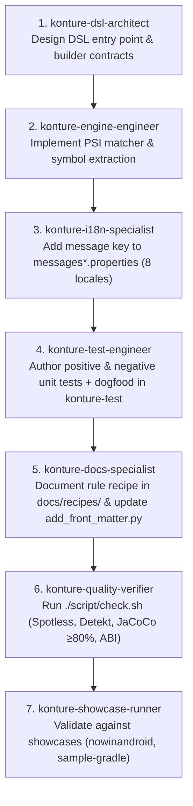

# Sub-Agent Ecosystem & Orchestration Playbook

This directory contains the autonomous sub-agent definitions for developing, refactoring, localizing, testing, documenting, and verifying **Konture**—the stack- and build-tool agnostic Kotlin architecture testing library for Android, Kotlin Multiplatform (KMP), and JVM backend projects.

---

## 1. Consolidated Sub-Agent Roster (8 Specialists)

| Sub-Agent | Specialty | Key Responsibilities | Tools |
| :--- | :--- | :--- | :--- |
| **[`konture-dsl-architect`](file:///Users/baoleduc/workspace/konture/.agents/agents/konture-dsl-architect.md)** | Architecture & DSL API Design | Designs fluent architecture testing APIs (`classes()`, `modules()`, `files()`, `slices()`, `layeredArchitecture()`, `functions()`, `properties()`), `@KontureDsl` scoping, and Kotlin Binary Compatibility (`checkKotlinAbi`). | `view_file`, `replace_file_content`, `write_to_file`, `run_command` |
| **[`konture-engine-engineer`](file:///Users/baoleduc/workspace/konture/.agents/agents/konture-engine-engineer.md)** | AST/PSI Engine & Cache | Manages Kotlin compiler embeddable PSI traversal (`PsiEnvironment`), incremental/persistent AST caching, symbol/type resolution (`TypeResolver`, `UsageExtractor`), cycle detection, and memory/daemon safety. | `view_file`, `replace_file_content`, `write_to_file`, `run_command` |
| **[`konture-plugin-engineer`](file:///Users/baoleduc/workspace/konture/.agents/agents/konture-plugin-engineer.md)** | Build Tool Plugins (Gradle & Maven) | Maintains `plugin-gradle` and `plugin-maven`, enforces Gradle Configuration Cache and Project Isolation compatibility (via `archLayoutElements`), AGP/KGP inspectors, and layout generation tasks. | `view_file`, `replace_file_content`, `write_to_file`, `run_command` |
| **[`konture-test-engineer`](file:///Users/baoleduc/workspace/konture/.agents/agents/konture-test-engineer.md)** | Test Lifecycle & Dogfooding | Full test lifecycle: unit tests in `:core` and `:library`, integration tests in `:plugin-gradle`, negative violation assertions (`assertFailsWith`), and dogfooding architecture tests in `konture-test`. | `view_file`, `replace_file_content`, `write_to_file`, `run_command` |
| **[`konture-i18n-specialist`](file:///Users/baoleduc/workspace/konture/.agents/agents/konture-i18n-specialist.md)** | 8-Language Localization (i18n) | Manages resource bundles across 8 supported locales (`en`, `fr`, `es`, `it`, `vi`, `zh`, `zh_CN`, `zh_TW`), `MessageFormat` apostrophe escaping (`''`), and locale-neutral baseline persistence. | `view_file`, `replace_file_content`, `write_to_file`, `run_command` |
| **[`konture-docs-specialist`](file:///Users/baoleduc/workspace/konture/.agents/agents/konture-docs-specialist.md)** | Documentation, Jekyll & Dokka | Manages Jekyll docs in `docs/` adhering to the zero-front-matter rule, registers metadata in `script/add_front_matter.py`, generates Dokka API docs (`dokkaHtmlMultiModule`), and authors architecture recipes. | `view_file`, `replace_file_content`, `write_to_file`, `run_command` |
| **[`konture-quality-verifier`](file:///Users/baoleduc/workspace/konture/.agents/agents/konture-quality-verifier.md)** | Code Review, ABI & Quality Gates | 3-stage semantic code review (Architecture, Craft/I/O/Memory, Tests), JaCoCo 80% coverage enforcement, file size limits (>300 lines), and runs the local pipeline (`./script/check.sh`). | `view_file`, `replace_file_content`, `write_to_file`, `run_command` |
| **[`konture-showcase-runner`](file:///Users/baoleduc/workspace/konture/.agents/agents/konture-showcase-runner.md)** | Showcases & Benchmarks | Validates real-world showcases (`nowinandroid`, `sample-gradle`, `sample-maven`, `ktor-arrow-example`, `kotlinconf-app`) and benchmarks large repository performance (`LargeRepositoryPerformanceBenchmarkTest`). | `view_file`, `replace_file_content`, `write_to_file`, `run_command` |

---

## 2. Automatic Delegation Principle

The primary agent operates as an **Orchestrator** and **automatically delegates** domain tasks to these specialists via `invoke_subagent` without requiring the user to explicitly specify agent names:
- **DSL API Scaffolding, Fluent Rules & ABI Stability** $\rightarrow$ `konture-dsl-architect`
- **PSI/AST Parsing, Caching, Symbol Resolution & Cycles** $\rightarrow$ `konture-engine-engineer`
- **Gradle/Maven Plugins, AGP/KGP Inspectors & Config Cache** $\rightarrow$ `konture-plugin-engineer`
- **Unit Testing, Dogfooding & Negative Violation Tests** $\rightarrow$ `konture-test-engineer`
- **8-Language Translations, MessageFormat & Baseline Invariants** $\rightarrow$ `konture-i18n-specialist`
- **Jekyll Documentation, Dokka API Docs & Recipes** $\rightarrow$ `konture-docs-specialist`
- **Semantic Code Review, Coverage Gate & Local Verification** $\rightarrow$ `konture-quality-verifier`
- **Real-World Showcases & Performance Benchmarks** $\rightarrow$ `konture-showcase-runner`

When a prompt combines disciplines (e.g., *"Add a new DSL rule for banning reflection, localize it in all languages, and add docs"*), the orchestrator automatically invokes `konture-dsl-architect`, followed by `konture-i18n-specialist`, `konture-test-engineer`, and `konture-docs-specialist`.

### Phased Sub-Agent Pipeline (No Concurrent Gradle Operations)

To prevent Gradle daemon lock contention and corrupted cache states, the orchestrator **MUST serialize sub-agent execution** into ordered phases when tasks involve build or test steps. **Never run Gradle tasks concurrently across multiple subagents**:
1. **Phase 1 (Specification & API Design):** `konture-dsl-architect` (designing API signatures, scoping, and AST matchers).
2. **Phase 2 (Engine & Localization):** `konture-engine-engineer` (parsing and caching) and `konture-i18n-specialist` (syncing message keys across all 8 locales).
3. **Phase 3 (Testing & Dogfooding):** `konture-test-engineer` (unit tests and dogfooding architecture tests).
4. **Phase 4 (Documentation & Recipes):** `konture-docs-specialist` (recipes, Jekyll metadata mapping, Dokka docs).
5. **Phase 5 (Quality Verification & Review):** `konture-quality-verifier` (Spotless, Detekt, ABI checks, JaCoCo $\ge 80\%$ coverage, and `./script/check.sh`).

---

## 3. Orchestration Playbooks

### Playbook 1: End-to-End Feature / DSL Rule Addition
When introducing a new architecture rule or DSL capability (e.g., *Annotation Retention Check*, *Banned Inheritance*):



---

### Playbook 2: Bug Fix & Parser Diagnostics
When resolving an AST parsing failure, symbol resolution false positive, or baseline bug:
1. **`konture-test-engineer`**: Author a reproducing test case in `:library:test` capturing the edge case with an exact assertion.
2. **`konture-engine-engineer`**: Fix the PSI traversal, type alias resolution, or AST cache invalidation logic.
3. **`konture-test-engineer`**: Re-run the target test to verify the fix passes cleanly.
4. **`konture-quality-verifier`**: Run `./gradlew -q spotlessApply` and verify `./script/check.sh`.

---

### Playbook 3: Build Tool Plugin Enhancement
When modifying Gradle or Maven plugins (e.g., supporting a new AGP/KGP version, Gradle Project Isolation, or Maven Mojo):
1. **`konture-plugin-engineer`**: Update inspectors (`AgpInspector`, `KgpInspector`) or layout generation tasks.
2. **`konture-test-engineer`**: Run plugin unit & integration tests (`./gradlew -q :plugin-gradle:test`).
3. **`konture-showcase-runner`**: Publish to maven local (`./gradlew -q publishToMavenLocal`) and verify with `showcases/nowinandroid` or `showcases/sample-maven`.
4. **`konture-quality-verifier`**: Run `./script/check.sh`.

---

### Playbook 4: Localization & 8-Language Synchronization
When adding new rule violation messages, assertion failures, or reviewing translations:
1. **`konture-i18n-specialist`**:
   - Add new base English keys to `library/src/main/resources/.../messages.properties`.
   - Propagate translations across all 7 locale files (`messages_fr.properties`, `messages_es.properties`, `messages_it.properties`, `messages_vi.properties`, `messages_zh.properties`, `messages_zh_CN.properties`, `messages_zh_TW.properties`).
   - Double all literal apostrophes (`''`) for `MessageFormat` compliance.
   - Run automated bundle parity & apostrophe linter: `python3 script/audit_i18n.py`.
   - Verify `BaselineNormalizer` keeps serialized baselines invariant across locales.
2. **`konture-test-engineer`**: Run `./gradlew -q :library:test --tests "io.github.baole.konture.impl.I18nTest"`.

---

### Playbook 5: Documentation & Jekyll Website Update
When adding or updating recipes, articles, or guides:
1. **`konture-docs-specialist`**:
   - Edit or create markdown files in `docs/` without adding YAML front matter.
   - For new files, add entry to `FRONT_MATTER_MAP` in `script/add_front_matter.py`.
   - Validate metadata: `python3 script/add_front_matter.py --validate`.
   - Generate Dokka docs: `./gradlew -q dokkaHtmlMultiModule`.
2. **`konture-quality-verifier`**: Verify documentation links and code snippets.

---

### Playbook 6: Semantic Code Review, ABI Stability & Local Verification
When reviewing PRs/diffs or before opening a pull request:
1. Run **`konture-quality-verifier`**:
   - **Stage 1 (Semantic Code Review)**: Inspect `git diff` against base branch for architecture boundaries, no compiler classpath leaks, and configuration cache safety.
   - **Stage 2 (Craft & Resources)**: Check file streams closed with `.use {}`, no daemon memory leaks, zero hardcoded strings.
   - **Stage 3 (File Decomposition & Invariant Audit)**:
     ```bash
     python3 script/audit_architecture.py --changed-only
     ```
   - **Stage 4 (Fast Agent Pre-Flight Quality Gate)**:
     ```bash
     ./script/preflight.sh
     ```
   - **Stage 5 (Full Verification Pipeline)**:
     ```bash
     ./script/check.sh
     ```

---

### Playbook 7: Benchmarking & Showcase Validation
When making performance optimizations or changes affecting real-world project builds:
1. **`konture-showcase-runner`**:
   - Run local benchmarks: `./gradlew -q :library:test --tests "*LargeRepositoryPerformanceBenchmarkTest*"`
   - Validate against showcases: `./gradlew -q publishToMavenLocal` followed by running checks in `showcases/nowinandroid` and `showcases/sample-gradle`.

---

## 🎯 Primary Engineering Skills & Workflows

Konture equips autonomous agents with two high-level engineering skills in `.agents/skills/`:

| Skill | Directory | Description & When to Use |
| :--- | :--- | :--- |
| **`ship-feature`** | [`.agents/skills/ship-feature/SKILL.md`](skills/ship-feature/SKILL.md) | **Autonomous End-to-End Feature Delivery Lifecycle**: Scaffolds, tests, verifies (`preflight.sh`, `check.sh`), opens PR, conducts 5-pass iterative adversarial code review, and merges PR. Use when asked to *"ship feature X"*, *"implement and merge X"*, or *"deliver X end-to-end"*. |
| **`github-ticket-workflow`** | [`.agents/skills/github-ticket-workflow/SKILL.md`](skills/github-ticket-workflow/SKILL.md) | **10-Step GitHub Issue-to-PR Lifecycle**: Triage & usefulness analysis (flags unclear issues), isolated Git worktree development, human approval gate, 6-dimension deep technical review, GitHub Actions CI loop, and PR delivery (never auto-merges). Use when asked to *"work on issue #X"* or *"resolve ticket #X"*. |

