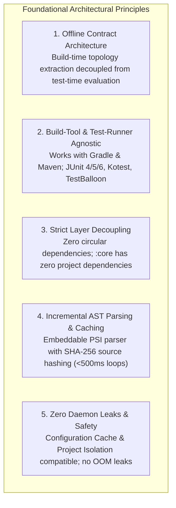
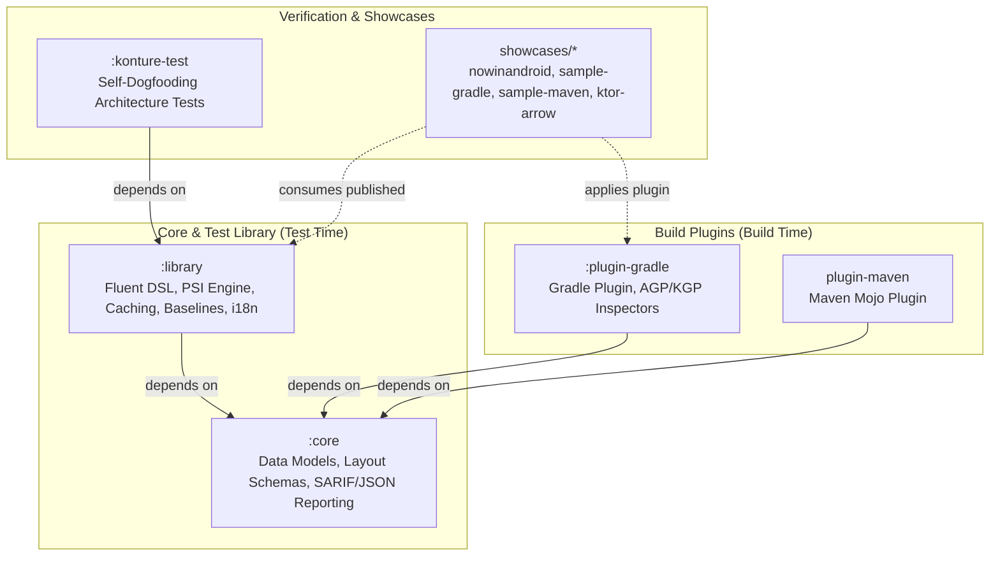
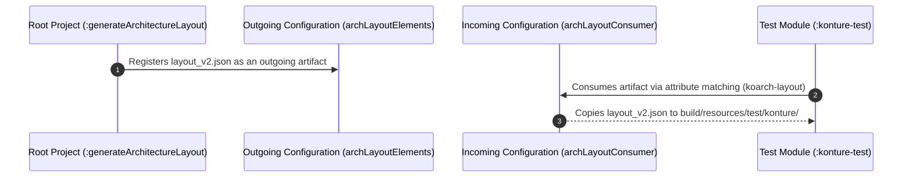
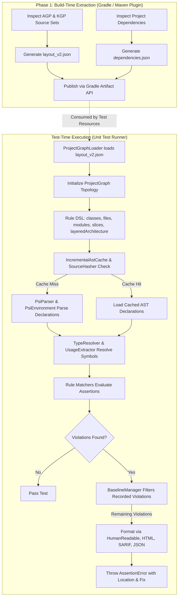

# Konture Architecture

This document defines the architectural blueprint, module hierarchy, execution pipeline, and design invariants for **Konture**—a stack- and build-tool agnostic Kotlin architecture testing library for Android, Kotlin Multiplatform (KMP), and JVM backend projects.

---

## 1. Architectural Goals & Core Principles

Konture is engineered around five foundational architectural principles:



### 1. The "Offline Contract" Architecture
Traditional architecture testing tools for the JVM often inspect compiled bytecode (`.class` files) via reflection or byte-code analyzers like ASM. This approach has critical drawbacks in modern Kotlin ecosystems:
- Bytecode analysis requires compiling all target classes before tests can run, slowing the developer feedback loop.
- It loses rich source-level context such as source set boundaries (`production` vs `test`), Kotlin modifiers (`internal`, `inline`, `value class`), type aliases, and custom file organization.
- It struggles with multi-module and multiplatform topologies without heavy runtime classpath coupling.

Konture solves this by separating **Build-Time Extraction** from **Test-Time Evaluation** via an offline JSON contract (`layout_v2.json` and `dependencies.json`). At build time, the build plugin extracts module hierarchies, source set mappings, and dependency graphs. At test time, architecture tests run as ordinary, ultra-fast unit tests that parse Kotlin source files on demand via a lightweight embeddable PSI engine.

### 2. Build-Tool and Test-Runner Agnostic
- **Build Tools**: First-class support for both **Gradle** (supporting Android, KMP, and JVM) and **Maven**.
- **Test Frameworks**: Because Konture evaluates rules inside standard JVM test runners, tests can be authored using **JUnit 4**, **JUnit 5**, **JUnit 6**, **Kotest**, or plain executable main functions.

### 3. Strict Compile-Time Layer Decoupling
The codebase enforces a strict unidirectional dependency hierarchy. Core data models have zero dependencies on compiler or build-tool internals, ensuring that consumers never pull unwanted compiler dependencies into their production or test classpaths.

### 4. Incremental Performance (<500ms Target)
Architecture tests must run on every commit and pre-push hook. Konture achieves sub-second execution through:
- AST caching (`IncrementalAstCache`, `PersistentAstCache`).
- Fast SHA-256 source hashing (`SourceHasher`) to parse only modified files.
- Avoiding full Kotlin compiler semantic analysis or bytecode generation.

### 5. Gradle Configuration Cache & Project Isolation Safety
Modern Gradle builds require Configuration Cache and Project Isolation compatibility. Konture shares artifacts using Gradle's **Consuming/Publishing Artifacts API** with attribute matching, completely avoiding cross-project model references (`parent.subprojects`).

---

## 2. Multi-Module Project Structure

Konture is partitioned into clear, decoupled modules:

```
konture/
├── core/                   # Pure domain models, AST abstractions, SARIF/JSON reporting, violations
├── library/                # Fluent DSL, PSI/AST parser engine, caching, baseline manager, i18n
├── plugin-gradle/          # Gradle plugin, AGP/KGP inspectors, layout/graph generation tasks
├── plugin-maven/           # Maven plugin Mojo for Maven project topology extraction
├── konture-test/           # Standalone integration test suite dogfooding Konture on itself
├── showcases/              # Real-world showcases demonstrating Konture integrations
│   ├── nowinandroid/       # 30+ module modern Android showcase (Compose, Hilt, AGP)
│   ├── sample-gradle/      # Minimal multi-module Gradle showcase
│   ├── sample-maven/       # Minimal multi-module Maven showcase
│   ├── ktor-arrow-example/ # JVM Ktor backend microservice showcase
│   └── kotlinconf-app/     # Kotlin Multiplatform (KMP) multi-target showcase
├── build-logic/            # Gradle convention plugins (quality, kotlin, publishing, root)
└── docs/                   # GitHub Pages Jekyll documentation (GFM without front matter)
```



### Module Responsibilities:

- **`:core`**:
  - Houses immutable domain models (`ModuleModel`, `SourceSetModel`, `DependencyEdge`, `DependencyGraphModel`, `LayoutModel`).
  - Houses reporting formats (`Violation`, `Severity`, `RuleMetadata`, `SarifReport`, `KontureJsonReport`).
  - **Invariants**: Zero internal dependencies on `:library`, `:plugin-gradle`, or compiler libraries. Highly portable.
- **`:library`**:
  - Houses the user-facing fluent architecture testing DSL (`Konture`, `classes()`, `files()`, `functions()`, `properties()`, `modules()`, `slices()`, `layeredArchitecture()`).
  - Houses the Kotlin embeddable PSI parser (`PsiEnvironment`, `DeclarationParser`).
  - Houses incremental and persistent AST caching (`IncrementalAstCache`, `PersistentAstCache`, `SourceHasher`).
  - Houses the baseline engine (`BaselineManager`, `BaselineNormalizer`, `BaselineSerializer`).
  - Houses 8-language localization (`Messages.kt`, `messages*.properties`).
- **`:plugin-gradle`**:
  - Implements Gradle plugin `io.github.baole.konture`.
  - Implements `GenerateArchitectureLayout` (creates `layout_v2.json`) and `GenerateDependencyGraph` (creates `dependencies.json`).
  - AGP and KGP inspectors (`AgpInspector`, `KgpInspector`) extracting source set configurations safely.
  - Implements `KontureSettingsPlugin` hooking projects via `settings.gradle.lifecycle.beforeProject`.
- **`plugin-maven`**:
  - Implements Maven Mojo scanning Maven project structures and generating matching layout models.
- **`:konture-test`**:
  - Independent verification test suite dogfooding Konture's architecture rules against Konture's own code.

---

## 3. Module Dependency Matrix & Enforcement

To prevent architectural drift and dependency tangling, Konture strictly enforces its own module dependency matrix:

| Module | `:core` | `:library` | `:plugin-gradle` | `plugin-maven` | External Compiler |
| :--- | :---: | :---: | :---: | :---: | :---: |
| **`:core`** | — | ❌ FORBIDDEN | ❌ FORBIDDEN | ❌ FORBIDDEN | ❌ FORBIDDEN |
| **`:library`** | ✅ ALLOWED | — | ❌ FORBIDDEN | ❌ FORBIDDEN | ✅ Embeddable PSI |
| **`:plugin-gradle`** | ✅ ALLOWED | ❌ FORBIDDEN | — | ❌ FORBIDDEN | ❌ FORBIDDEN |
| **`plugin-maven`** | ✅ ALLOWED | ❌ FORBIDDEN | ❌ FORBIDDEN | — | ❌ FORBIDDEN |
| **`:konture-test`** | ✅ Via `:library` | ✅ ALLOWED | ❌ Test classpath only | ❌ FORBIDDEN | ❌ FORBIDDEN |

This matrix is continuously validated by Konture in [`konture-test/src/test/kotlin/io/github/baole/konture/tests/ArchitectureTest.kt`](konture-test/src/test/kotlin/io/github/baole/konture/tests/ArchitectureTest.kt):

```kotlin
@Test
fun `module dependency rules verified via archunit style`() {
    // :core should not depend on anything other than external libraries
    Konture.modules().that().haveNamePath(":core").should().onlyDependOn().check()

    // :library should only depend on :core
    Konture.modules().that().haveNamePath(":library").should().onlyDependOn(":core").check()

    // :plugin-gradle should only depend on :core
    Konture.modules().that().haveNamePath(":plugin-gradle").should().onlyDependOn(":core").check()
}
```

---

## 4. Build System & Gradle Architecture

Konture's build infrastructure uses Gradle composite builds and convention plugins in `build-logic/`:

### 1. Convention Plugins (`build-logic/`)
- **`konture.root.gradle.kts`**: Root project convention configuring Spotless (with Ktlint, license headers, trim trailing whitespace), aggregated JaCoCo reporting, and contributors generation.
- **`konture.kotlin.gradle.kts`**: Configures Kotlin JVM target 17, `explicitApiWarning()`, compiler flags (`-Xjsr305=strict`), and Binary Compatibility Validator (`abiValidation()`).
- **`konture.quality.gradle.kts`**: Enforces code quality gates:
  - **JaCoCo**: Enforces **80% minimum bundle instruction coverage** (`minimum = "0.80"`).
  - **Detekt**: Static analysis with baselines and custom rule configuration.
  - **Ktlint**: Formatting checks and autofixes.
  - **Dokka**: Multi-module KDoc generation (`dokkaHtmlMultiModule`).
- **`konture.publishing.gradle.kts`**: Maven Central publishing and NMCP signing.

### 2. Gradle Project Isolation & Artifact Sharing
Direct project-to-project references (`project(":other").tasks`) violate Gradle Project Isolation. Konture shares build topology using Gradle's **Consuming/Publishing Artifacts API**:



1. Root project task `generateArchitectureLayout` generates `layout_v2.json`.
2. The root project registers this file as an outgoing artifact in configuration `archLayoutElements` with attribute `artifactType = "koarch-layout"`.
3. Consumer test modules register a consumer configuration matching this attribute, copying `layout_v2.json` into test resources without cross-project model access.

---

## 5. End-to-End Execution Pipeline

Konture executes through six distinct phases spanning build time and test time:



### Phase 1: Build-Time Topology Extraction
- `GenerateArchitectureLayout` inspects every module, flavor, and source set (using `AgpInspector` and `KgpInspector`) and writes `layout_v2.json`.
- `GenerateDependencyGraph` extracts project and external dependencies into `dependencies.json`.

### Phase 2: Test-Time Topology Loading
- `ProjectGraphLoader` deserializes `layout_v2.json` and `dependencies.json` into the in-memory `ProjectGraph`.
- The graph maps modules, source set directories, and inter-module edges.

### Phase 3: AST / PSI Parsing & Incremental Caching
- When an architecture rule executes (e.g. `Konture.classes().that()...`), Konture locates relevant `.kt` files.
- `SourceHasher` computes SHA-256 hashes of source files.
- `IncrementalAstCache` and `PersistentAstCache` return cached declaration models for unmodified files.
- For modified or new files, `PsiParser` and `PsiEnvironment` parse the file into a Kotlin PSI tree (`KtFile`), extracting declarations (`KtClass`, `KtNamedFunction`, `KtProperty`, `KtImportDirective`).

### Phase 4: Symbol & Type Resolution
- `TypeResolver`, `UsageExtractor`, and `DeclaredClassScanner` resolve imports, qualified names, and types without requiring bytecode compilation.
- Handles nested types, type aliases, and standard library primitives.

### Phase 5: Rule & Matcher Evaluation
- Filter predicates (`*ThatScope`) narrow the set of target elements.
- Assertion predicates (`*ShouldScope`) evaluate constraints (e.g. `onlyDependOn`, `resideInPackage`, `haveNameEndingWith`, `notCall`).
- Set algebra (`and()`, `or()`, `not()`) combines predicates cleanly.

### Phase 6: Baselines, Suppressions & Violation Reporting
- `@SuppressArchitecture` and `@Suppress("konture:...")` annotations are checked to bypass violations at the source level.
- `BaselineManager` loads recorded violations from baseline files, using `BaselineNormalizer` to ensure locale-neutral comparisons.
- Remaining violations are formatted via `HumanReadableViolationFormatter`, `HtmlReportWriter`, `SarifReport`, or `KontureJsonReport`.
- If violations remain, an actionable `AssertionError` is thrown containing precise file locations and suggested remediations.

---

## 6. Internationalization (i18n) Architecture

Konture features a built-in internationalization engine (`io.github.baole.konture.i18n.Messages`):

- **8 Supported Locales**: English (`en`), French (`fr`), Spanish (`es`), Italian (`it`), Vietnamese (`vi`), Chinese (`zh`), Simplified Chinese (`zh_CN`), Traditional Chinese (`zh_TW`).
- **Resource Bundles**: Stored under `library/src/main/resources/io/github/baole/konture/i18n/messages*.properties`.
- **Dynamic Formatting**: Uses `java.text.MessageFormat` with indexed arguments (`{0}`, `{1}`).
- **Escaping Protocol**: Literal apostrophes **must be doubled** (`''`) to prevent `MessageFormat` from swallowing placeholders.
- **Locale-Neutral Baseline Normalization**: When recording violations into baselines, `BaselineNormalizer` strips locale-specific strings and records canonical keys, ensuring baselines generated on any machine remain identical across developer environments and CI runners.

---

## 7. Performance, Memory & Daemon Safety Guardrails

Because Konture runs inside persistent Gradle daemons and continuous CI pipelines, memory hygiene is strictly enforced:

1. **Daemon Safety**:
   - PSI trees and compiler environments (`PsiEnvironment`) must not be retained in static memory indefinitely.
   - AST caches use soft references or eviction strategies to avoid daemon heap starvation.
2. **File Descriptor Safety**:
   - All file I/O operations (reading layout JSON, parsing source files) must use `.use { ... }` or automatic resource management to prevent leaking open file descriptors.
3. **Execution Time Budget**:
   - In-memory parsing of typical Kotlin modules takes <100ms.
   - Full repository architecture checks for large projects (30+ modules) execute in <500ms when AST caches are warm.
4. **Benchmarking**:
   - `LargeRepositoryPerformanceBenchmarkTest` tests synthetic repositories with 100+ modules and thousands of classes to prevent algorithmic regressions ($O(N^2)$ cycle detection or excessive memory allocations).
