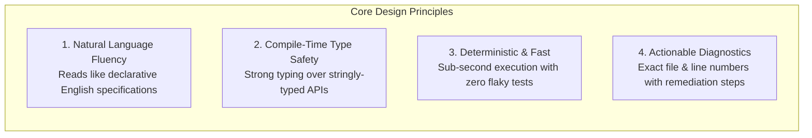
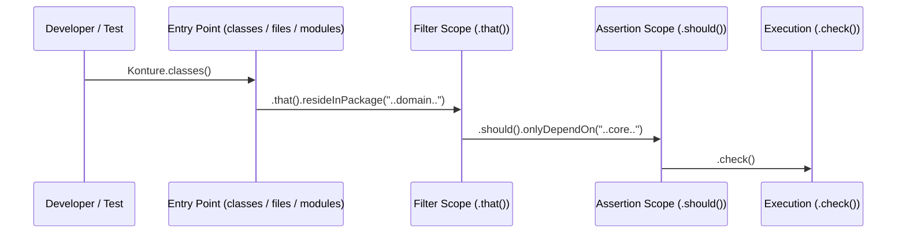

# Konture Design System & API Specifications

This document defines the API ergonomics, fluent DSL design system, diagnostic formatting, visual reporting, and internationalization specifications for **Konture**.

---

## 1. Vision & Core Principles

Konture elevates Kotlin architectural enforcement from ad-hoc script checks into a first-class, declarative **Architecture as Code** discipline.



1. **Natural Language Fluency**: Architecture tests must read like self-documenting architectural requirements that both developers and architects can immediately understand.
2. **Compile-Time Type Safety**: Prefer strongly-typed Kotlin language constructs, builder interfaces, and extension functions over stringly-typed queries.
3. **Deterministic & Fast**: Tests must never be flaky. Tests run against static AST structures and deterministic metadata with sub-second execution speeds.
4. **Actionable Diagnostics**: When an architectural rule fails, the error message must not just say *"failed"*. It must pinpoint:
   - What subject failed (class, function, file, or module).
   - Exactly where it occurred (`file:///path/to/File.kt#L42`).
   - Why it violated the architecture rule.
   - Concrete suggested actions to fix it.

---

## 2. Fluent DSL Design System

Every Konture rule adheres strictly to a 4-phase fluent grammar:

$$\mathbf{Subject} \longrightarrow \mathbf{Filter\ (.that())} \longrightarrow \mathbf{Assertion\ (.should())} \longrightarrow \mathbf{Execution\ (.check())}$$



### 1. Subject Entry Points
Konture exposes seven primary declarative entry points under the `Konture` namespace:

| Entry Point | Scope | Typical Use Cases |
| :--- | :--- | :--- |
| `classes()` | Class & Interface declarations | Package rules, inheritance, modifiers, annotations, dependencies |
| `files()` | Kotlin source files (`.kt`) | File naming conventions, file paths, import restrictions |
| `functions()` | Top-level and member functions | Return types, parameter types, banned API calls (`notCall`) |
| `properties()` | Properties & Fields | Immutability (`val` vs `var`), property types, visibility |
| `modules()` | Build modules / Subprojects | Inter-module dependencies, allowed external libraries, module layout |
| `slices()` | Horizontal feature slices | Package slicing, cyclic slice dependencies, cross-slice boundaries |
| `layeredArchitecture()` | Multi-tier architectural layers | Onion, Hexagonal, Clean Architecture layer access constraints |

---

### 2. Scoping, Markers & Scope Isolation
To avoid method leaking and autocomplete confusion (e.g., offering assertion methods inside a filter clause), Konture enforces strict DSL boundaries:

- **`@KontureDsl`**: All builder scopes are annotated with `@KontureDsl` to prevent improper nesting.
- **Dedicated Scope Interfaces**:
  - `ClassesScope` $\rightarrow$ `ClassesThatScope` $\rightarrow$ `ClassesShouldScope`
  - `FilesScope` $\rightarrow$ `FilesThatScope` $\rightarrow$ `FilesShouldScope`
  - `ModulesScope` $\rightarrow$ `ModulesThatScope` $\rightarrow$ `ModulesShouldScope`
- **Builder Immutability**: Intermediate builder stages return isolated immutable scopes, preventing state mutation across chained calls.

---

### 3. Set Algebra & Boolean Composition
Filters and assertions support fluent boolean operators:
- **`and()`**: Conjunction of two predicates.
- **`or()`**: Disjunction of two predicates.
- **`not()`**: Inversion of a predicate.

```kotlin
// Example: classes that reside in domain AND do not have name ending with 'Impl'
Konture.classes()
    .that()
    .resideInPackage("..domain..")
    .and()
    .not()
    .haveNameEndingWith("Impl")
    .should()
    .beInterfaces()
    .check()
```

---

### 4. Source Set Scoping
Architecture rules can be constrained to specific compilation variants:
- **`onSourceSets("main")`**: Evaluates only production source sets.
- **`productionOnly()`**: Bypasses unit tests, Android test variants, and test fixtures.
- **`testOnly()`**: Enforces conventions specifically on test classes (e.g. naming test classes with suffix `Test`).

---

### 5. Binary Compatibility & API Evolution
Konture enforces strict Kotlin Binary Compatibility via `kotlinx.binary-compatibility-validator`:
- All public DSL entry points, interfaces, and open classes are tracked in `api/*.api` dump files.
- `explicitApiWarning()` is enabled in `build-logic/src/main/kotlin/konture.kotlin.gradle.kts`.
- Internal implementation details (PSI parsing, cache internals, AST nodes) reside in `*.impl.*` packages and are marked `internal`.

---

## 3. Visual & Reporting Design System

Konture provides rich diagnostic output across multiple mediums:

### 1. Terminal & CLI Design
Terminal outputs are formatted with ANSI colors for high developer scannability:

```text
[ERROR] Architecture Rule Violation: 'Domain layer must not depend on UI layer'
  Module: :feature:auth
  Location: file:///Users/developer/project/feature/auth/src/main/kotlin/AuthViewModel.kt:42
  Violation: Class 'AuthViewModel' in package 'com.example.domain' directly references 'com.example.ui.LoginScreen'.
  Fix: Move UI references to ':feature:auth:ui' or communicate via domain abstractions.

Summary: 1 rule evaluated, 1 violation found (0 suppressed, 0 baselined).
```

Konture also formats violations as **GitHub Actions Problem Matchers**:
```text
::error file=/Users/developer/project/AuthViewModel.kt,line=42,col=1::Class 'AuthViewModel' violates rule: Domain layer must not depend on UI layer
```

---

### 2. HTML Violation Report Design System
Konture generates standalone interactive HTML reports (`build/reports/konture/konture-report.html`):

#### Color Palette & Design Tokens:
- **Canvas / Background**: Light `#F8FAFC` | Dark `#0F172A`
- **Surface / Card**: Light `#FFFFFF` | Dark `#1E293B`
- **Border / Divider**: Light `#E2E8F0` | Dark `#334155`
- **Text Primary**: Light `#0F172A` | Dark `#F8FAFC`
- **Text Muted**: Light `#64748B` | Dark `#94A3B8`

#### Semantic Status Badges:

| Severity | Badge Background | Text Color | Border Color | Hex Code |
| :--- | :--- | :--- | :--- | :--- |
| **`ERROR`** | `#FEF2F2` | `#991B1B` | `#F87171` | `#DC2626` |
| **`WARNING`** | `#FFFBEB` | `#92400E` | `#FBBF24` | `#D97706` |
| **`INFO`** | `#EFF6FF` | `#1E40AF` | `#60A5FA` | `#2563EB` |
| **`SUCCESS`** | `#F0FDF4` | `#166534` | `#4ADE80` | `#16A34A` |

#### Interactive Features:
- **Search Bar**: Instant client-side filtering by class name, file name, or rule ID.
- **Module Filter Dropdown**: Narrow violations to specific Gradle/Maven modules.
- **Expandable Violation Traces**: Accordion views showing full AST path, imports, and source snippets.
- **Interactive Dependency Graph**: Visual DAG of project modules with violation highlights.

---

### 3. SARIF 2.1.0 & JSON Schemas
For enterprise CI/CD integration, Konture generates standard SARIF (Static Analysis Results Interchange Format) files:
- Compatible with GitHub Advanced Security / Code Scanning.
- Compatible with SonarQube, DefectDojo, and IDE SARIF viewers.
- Conforms to OASIS SARIF v2.1.0 standard schema.

---

## 4. Internationalization (i18n) & Microcopy Design

Konture supports **8 languages**:

| Language | Locale | File |
| :--- | :--- | :--- |
| English (Canonical Source) | `en` | `library/src/main/resources/io/github/baole/konture/i18n/messages.properties` |
| French | `fr` | `library/src/main/resources/io/github/baole/konture/i18n/messages_fr.properties` |
| Spanish | `es` | `library/src/main/resources/io/github/baole/konture/i18n/messages_es.properties` |
| Italian | `it` | `library/src/main/resources/io/github/baole/konture/i18n/messages_it.properties` |
| Vietnamese | `vi` | `library/src/main/resources/io/github/baole/konture/i18n/messages_vi.properties` |
| Chinese (Base) | `zh` | `library/src/main/resources/io/github/baole/konture/i18n/messages_zh.properties` |
| Chinese (Simplified) | `zh_CN` | `library/src/main/resources/io/github/baole/konture/i18n/messages_zh_CN.properties` |
| Chinese (Traditional) | `zh_TW` | `library/src/main/resources/io/github/baole/konture/i18n/messages_zh_TW.properties` |

### Microcopy Formatting Rules:
1. **Positional Parameters**: Always index arguments (`{0}`, `{1}`, `{2}`).
2. **Java `MessageFormat` Escaping**: Always double single quotes (`''`) in properties files (e.g., `l''architecture`, `doesn''t`).
3. **Locale-Neutral Baselines**: Baselines store normalized, locale-neutral keys to prevent baseline churn across international teams.

---

## 5. Architectural Rule Design Patterns & Recipes

### 1. Layered Architecture (Clean / Onion)
```kotlin
Konture.layeredArchitecture()
    .layer("Presentation").definedBy("..presentation..")
    .layer("Domain").definedBy("..domain..")
    .layer("Data").definedBy("..data..")
    .whereLayer("Presentation").mayOnlyAccessLayers("Domain")
    .whereLayer("Data").mayOnlyAccessLayers("Domain")
    .whereLayer("Domain").mayNotAccessAnyLayer()
    .check()
```

### 2. Prohibiting Banned APIs / Calls
```kotlin
Konture.functions()
    .that()
    .resideInPackage("..domain..")
    .should()
    .notCall("android.util.Log")
    .because("Domain layer must be pure Kotlin without Android SDK dependencies")
    .check()
```

### 3. Preventing Type Leakage
```kotlin
Konture.classes()
    .that()
    .resideInPackage("..api..")
    .should()
    .notDependOnClassesThat()
    .resideInPackage("..internal..")
    .because("Public API models must not expose internal types")
    .check()
```

### 4. Enforcing Immutability
```kotlin
Konture.properties()
    .that()
    .resideInClassesThat()
    .areDataClasses()
    .should()
    .beVal()
    .because("Data classes should be immutable value objects")
    .check()
```

### 5. Cyclic Dependency Prevention
```kotlin
// Modules
Konture.assertNoCycles()

// Slices / Features
Konture.slices()
    .matching("com.example.feature.(*)..")
    .should()
    .beFreeOfCycles()
    .check()
```
